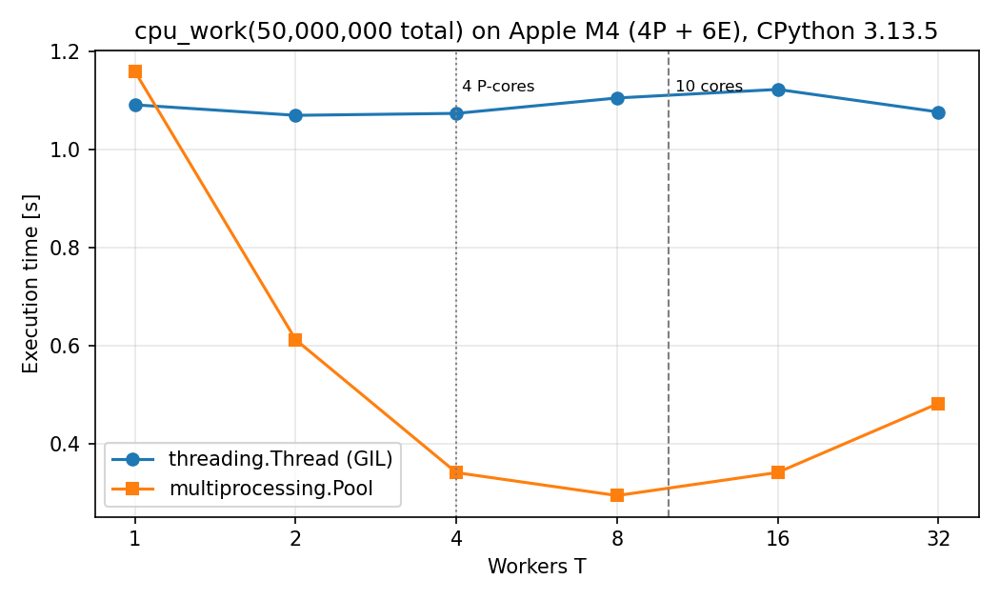

# Silicon Profiling Lab: Empirical Microarchitectural Bottlenecks

| Student & hardware field | Value |
|---|---|
| Student full name | Akbota Kutushova |
| Student ID | 230103377 |
| Date & laboratory session | 2026-11-27, Week 3 Silicon Profiling Lab |
| Workstation / laptop | Apple MacBook Pro (model identifier Mac16,1) |
| Processor SKU / SoC | Apple M4 (`machdep.cpu.brand_string`), ARM64 |
| Core topology | Physical cores: **10** (4 Performance + 6 Efficiency) \| Logical SMT threads: **10** (no SMT, so logical = physical) |
| Cache hierarchy | L1d: **128 KB** per P-core / **64 KB** per E-core \| L2: **16 MB** (P-cluster) / **4 MB** (E-cluster) \| L3: **not reported** (0 `l3cache` sysctl keys). Cache line: **128 bytes** |
| Host OS & Python | macOS 15.5 (24F74), Darwin 24.5.0 / CPython 3.13.5 (Anaconda, GIL enabled), numpy 2.1.3, multiprocessing start method `spawn` |
| Memory | 16 GB LPDDR5 (Micron), per `system_profiler SPMemoryDataType` |

Source of this table: `logs/hw_audit.txt` (produced by `hw_audit.sh`, the macOS commands from the worksheet appendix).

I measured every number below on this machine on 2026-11-27, running one benchmark at a time with nothing else running. Code was written with AI help, which the instructor allows. The required raw terminal logfile is **`results_230103377.txt`**: it joins all files in `logs/` unchanged (built by `make_results_file.sh`).

## Files

| File | Purpose |
|---|---|
| `task1_amdahl.py` | Task 1 benchmark, exactly as in the handout |
| `task1_pool_overhead.py` | Supplement: time of an empty `Pool` (spawn + IPC + shutdown) per core count |
| `task2_falsesharing.py` | Task 2 benchmark, exactly as in the handout (run 3 times) |
| `task2_falsesharing_c.c` | Supplement: the same adjacent vs padded test in C with pthreads (no GIL), strides 8 / 64 / 128 bytes |
| `task3_sync.py` | Task 3 benchmark, exactly as in the handout (run 3 times) |
| `task3_lockless.py` | Task 3 redesign: lockless thread-local accumulator (map-reduce), 5 runs vs `LockedCounter` |
| `task3_race_c.c` | Supplement: the unsafe counter in C with pthreads (no GIL) |
| `task4_roofline.py` | Task 4 benchmark, exactly as in the handout (run 3 times) |
| `task4_bandwidth.py` | Supplement: measured streaming bandwidth with 1, 2, 4, 8 processes |
| `bonus_gil_scaling.py` | Bonus task: `threading.Thread` vs `multiprocessing.Pool`, T = 1..32, with plot |
| `hw_audit.sh` | Hardware topology queries (worksheet appendix, macOS row) |
| `make_results_file.sh` | Builds `results_230103377.txt` from `logs/` |
| `logs/*.txt` | Console output of every run, saved with `tee` |
| `results/bonus_scaling.{json,png}` | Bonus task data and graph |

How to reproduce:
```sh
./hw_audit.sh | tee logs/hw_audit.txt
python3 task1_amdahl.py | tee logs/task1_amdahl.txt
python3 task1_pool_overhead.py | tee logs/task1_pool_overhead.txt
for i in 1 2 3; do echo "--- Trial $i ---"; python3 task2_falsesharing.py; done | tee logs/task2_falsesharing.txt
clang -O2 -pthread -o task2_falsesharing_c task2_falsesharing_c.c && ./task2_falsesharing_c | tee logs/task2_falsesharing_c.txt
for i in 1 2 3; do echo "--- Run $i ---"; python3 task3_sync.py; done | tee logs/task3_sync.txt
python3 task3_lockless.py | tee logs/task3_lockless.txt
clang -O2 -pthread -o task3_race_c task3_race_c.c && ./task3_race_c | tee logs/task3_race_c.txt
python3 task4_roofline.py | tee logs/task4_roofline.txt
python3 task4_bandwidth.py | tee logs/task4_bandwidth.txt
python3 bonus_gil_scaling.py | tee logs/bonus_gil_scaling.txt
./make_results_file.sh
```

---

## Task 1: Amdahl's law and physical silicon saturation

Source: `logs/task1_amdahl.txt`. Workload: 40,000,000 iterations of pure-Python integer math, split evenly over p `spawn` processes. Speedup = T(1) / T(p) with the baseline run T(1) = 1.1830 s. Efficiency = S(p) / p x 100.

| Worker cores (p) | Measured time T(p) [s] | Observed speedup S(p) | Ideal linear speedup | Parallel efficiency |
|---|---|---|---|---|
| p = 1 (baseline) | **1.1830** | 1.00x | 1.00x | 100.0% |
| p = 2 | 0.6043 | 1.96x | 2.00x | 97.9% |
| p = 4 | 0.3298 | 3.59x | 4.00x | 89.7% |
| p = 8 | 0.3115 | 3.80x | 8.00x | 47.5% |
| p = 12 | 0.2765 | 4.28x | 12.00x | 35.7% |
| p = 16 | 0.3081 | 3.84x | 16.00x | 24.0% |

The script's sweep also re-ran p = 1 and got 1.1603 s (1.02x), so run-to-run noise is about 2%.

Empty-pool cost (`logs/task1_pool_overhead.txt`, median of 3): 0.0285 s (p = 1), 0.0317 s (p = 4), 0.0474 s (p = 8), 0.0576 s (p = 12), 0.0972 s (p = 16).

### Q1.1: Inflection point
**p\* = 4.** Up to 4 workers the curve is almost linear (1.96x at p = 2, 3.59x at p = 4, 89.7% efficiency). From 4 to 8 workers the time only drops from 0.3298 s to 0.3115 s (3.59x to 3.80x), and efficiency falls to 47.5%.

This matches the M4 topology:
- **4 Performance cores.** With p ≤ 4, each process gets its own P-core.
- **6 Efficiency cores.** At p = 8, four processes must run on E-cores. Every process gets the same chunk (5,000,000 items), so the run ends when the slowest E-core chunk ends. T(8) ≈ T(4), even though each chunk is half as big. So on this loop an E-core needs about twice as long per item as a P-core, and the E-cores add almost nothing.
- **No SMT.** `hw.logicalcpu = hw.physicalcpu = 10`, so there are no hyperthreads. The best result, 4.28x, is at p = 12, close to the 10 physical cores (smaller chunks balance P and E cores a bit better). At p = 16 the 16 processes share 10 cores, so the OS time-slices them. The speedup drops to 3.84x, and the empty-pool cost alone is 0.0972 s, about 32% of T(16) = 0.3081 s.

### Q1.2: Parallel fraction P from T(1) and T(4)
S(4) = T(1) / T(4) = 1.1830 / 0.3298 = **3.5870**

Amdahl: 1 / S(4) = (1 − P) + P/4 = 1 − 0.75 P

1 / 3.5870 = 0.27878 → 0.75 P = 1 − 0.27878 = 0.72122 → **P = 0.9616** (serial fraction 1 − P = 0.0384, about 3.8%).

The serial part here is mostly Python process start-up (spawn, importing the module), pickling tasks/results over pipes, and pool shutdown. These are not in the loop itself.

### Q1.3: Asymptotic limit and the 128-core server
S_max = 1 / (1 − P) = 1 / 0.03838 = **26.06x.**

On a 128-core node, Amdahl gives S(128) = 1 / (0.03838 + 0.9616/128) = **21.8x**, which is 17% efficiency. About 107 of the 128 cores would be wasted, and no number of cores can beat 26x. Two things make it worse in practice:
- The serial part is not fixed. The empty-pool time grew from 0.0285 s (p = 1) to 0.0972 s (p = 16), so on 128 cores spawn/IPC costs would push S(p) well below 21.8x.
- P was fitted on 4 equal P-cores. With the same P, Amdahl predicts S(8) = 6.3x, but I measured 3.80x, because the E-cores are slower and the chunks are equal. Mixed core types or cores competing for memory make real speedup fall further below Amdahl.

For this workload, money is better spent on removing the serial overhead (reuse one pool, use bigger tasks, or compile the loop) than on a 128-core server.

---

## Task 2: Cache coherence and the false sharing trap

Source: `logs/task2_falsesharing.txt` (handout script, 3 separate runs). Slowdown multiplier = T_adjacent / T_padded (median).

| Memory layout | Trial 1 [s] | Trial 2 [s] | Trial 3 [s] | Median [s] | Slowdown penalty multiplier |
|---|---|---|---|---|---|
| Adjacent indices (false sharing active) | 0.4618 | 0.4498 | 0.4518 | **0.4518** | — [Baseline] |
| Padded indices (cache-line aligned) | 0.4624 | 0.4627 | 0.4441 | **0.4624** | 0.98x (adjacent / padded = 0.4518 / 0.4624) |

**Result: no false-sharing penalty in CPython.** The per-trial factors were 1.00x, 0.97x and 1.02x, all within noise. The reason is the GIL (CPython 3.13.5 with the GIL enabled). Only one of the 4 threads runs bytecode at a time, so two cores never write the line at the same moment. Each thread holds the GIL for a 5 ms switch interval (`sys.getswitchinterval() = 0.005`), so the cache line moves between cores only a few hundred times per second, not millions. Most of the time goes to the interpreter (about 23 ns per `+=`), not to coherence traffic.

To see the hardware effect, I ran the same experiment in C without a GIL (`task2_falsesharing_c.c`, `logs/task2_falsesharing_c.txt`). Setup: 4 pthreads, 100,000,000 increments each, buffer aligned to 128 bytes, 3 trials.

| Counter stride | Trial 1 [s] | Trial 2 [s] | Trial 3 [s] | Median [s] | vs 128-byte stride |
|---|---|---|---|---|---|
| 8 B (all 4 counters in one line) | 0.1584 | 0.1357 | 0.1351 | **0.1357** | **2.39x slower** |
| 64 B ("64-byte padding") | 0.0678 | 0.0928 | 0.0725 | **0.0725** | 1.28x slower |
| 128 B (one M4 line per counter) | 0.0705 | 0.0480 | 0.0568 | **0.0568** | 1.00x |

With real parallel threads, false sharing costs 2.39x here. The 64-byte padding that is enough on x86 is not enough on the M4: its line is 128 bytes, so counters 0/1 and 2/3 still share lines (1.28x slower).

### Q2.1: Size of a reference and why stride 16 works
A CPython list stores an array `ob_item` of `PyObject*` pointers. On 64-bit CPython each pointer is **8 bytes**. Measured (`logs/task2_python_sizes.txt`): `sys.getsizeof([0]*64) − sys.getsizeof([0]*4) = 568 − 88 = 480 bytes` for 60 extra elements, which is 8.0 bytes per slot. The integer object a slot points to is separate: `sys.getsizeof(0) = 28` bytes.

Proof: slot i is at address A_i = B + 8i, where B is the base of `ob_item`. Thread k writes slot 16k, so A_16k = B + 128k. For threads j < k the distance is 128(k − j) ≥ 128 bytes. A cache line of size L covers the addresses [nL, (n+1)L), so two addresses in the same line differ by at most L − 1:
- For L = 64 (the handout's line): 128 > 63, so the two slots can never share a line.
- For L = 128 (the M4's real line, `hw.cachelinesize = 128`): 128 > 127, so the guarantee still holds, just barely. Stride 8 (64 bytes) would *not* be enough on the M4, as the C table shows.

Adjacent indices are 8 bytes apart, so in the adjacent case all 4 slots fit in one 64- or 128-byte line (at most 2 lines if `ob_item` starts near a line boundary).

Caveat: `+=` on a Python int creates a new int object and changes reference counts. So the real memory traffic also touches the int objects on the heap, not only the slots.

### Q2.2: MESI trace for index 0 (Core 0) then index 1 (Core 1)
Start: both cores have read the line holding slots 0..3, so it is **Shared (S)** in both L1s.
1. **Core 0 writes index 0.** Core 0 has the line in S, so it cannot write yet. It sends a **BusUpgr / Invalidate** (on a read miss it would be a BusRdX, read-for-ownership) on the interconnect. Core 1 snoops the message and changes its copy **S → I (Invalid)**, then acknowledges. Core 0 changes **S → M (Modified)** and does the store. The line is now dirty, and Core 0 holds the only valid copy.
2. **Core 1 writes index 1.** Core 1's copy is Invalid, so this is a write miss and Core 1 sends **BusRdX**. Core 0 snoops it, supplies the dirty line (cache-to-cache transfer or write-back) and changes **M → I**. Core 1 loads the line and changes **I → M**, then does the store.
3. **Core 0 increments index 0 again.** Now Core 0 misses, sends BusRdX, and Core 1 changes **M → I** while Core 0 changes **I → M**. The line keeps moving between the cores ("ping-pong").

Every increment costs a coherence round trip (tens of ns, crossing to the other cluster if one core is a P-core and the other an E-core) instead of a ~1 ns L1 hit, even though the threads never touch the same variable. The C run measured this cost as 2.39x. Apple's coherence protocol is proprietary (a MESI/MOESI-style directory protocol), but the invalidate-on-write rule is the same.

### Q2.3: Two standard ways to remove false sharing
1. **C++11 `alignas` (compile-time alignment).** Write `struct alignas(64) Counter { std::atomic<long> v; };`. Better still, C++17 offers `alignas(std::hardware_destructive_interference_size)`, which lets the compiler and target choose the line size. The compiler places each object at an aligned address and rounds `sizeof` up to the alignment, so an array of counters gets one line per element. On Apple Silicon the value must be 128, as the 64-byte row above shows. Rust's `crossbeam::CachePadded` uses 128 on aarch64 Apple for this reason.
2. **Java `@jdk.internal.vm.annotation.Contended` (VM-level).** The JVM adds padding around the annotated field, or places it in its own group, when it builds the object layout. This works for user code with `-XX:-RestrictContended`. The JDK itself uses it in `LongAdder`/`Striped64` cells and in `Thread` fields. Because the VM picks the padding, the same bytecode works on any line size.
3. (Also) **Go struct padding.** Write `type padded struct { v uint64; _ [56]byte }`, or use `golang.org/x/sys/cpu.CacheLinePad`, which is sized for each architecture. Go's runtime pads per-P structures this way.

---

## Task 3: The synchronization tax and lockless redesign

Source: `logs/task3_sync.txt` (handout script, 3 runs). The table uses Run 1. The other runs are below it.

| Counter architecture | Target sum | Actual empirical sum | Data corruption defect count | Execution time [s] | Contention overhead |
|---|---|---|---|---|---|
| Unsafe accumulator (race condition) | 2,000,000 | **2,000,000** | **0** | 0.0570 | 1.00x [Baseline] |
| Locked accumulator (`threading.Lock`) | 2,000,000 | 2,000,000 | 0 (Protected) | 0.1545 | **2.71x** |

Runs 2 and 3: unsafe 0.0522 s / 0.0502 s, locked 0.1547 s / 0.1576 s, overhead 2.96x / 3.14x. Both runs also gave exactly 2,000,000 for the unsafe counter. Medians: unsafe 0.0522 s, locked 0.1547 s.

### Q3.1: The corrupted count, and why there was none in Python
My exact unsafe count was **2,000,000 / 2,000,000 in all 3 runs, so 0 lost updates**. I report this honestly, not a made-up corrupted value. The race is still real but hidden by CPython 3.13's GIL. `logs/task3_unsafe_inc_bytecode.txt` shows that `self.val += 1` compiles to `LOAD_ATTR val → BINARY_OP += → STORE_ATTR val`. CPython only switches threads at "eval breaker" points, such as `RESUME` at function entry and backward jumps in loops. There is none between the `LOAD_ATTR` and the `STORE_ATTR`, so a thread is never interrupted halfway through the read-modify-write. In practice each `inc()` runs as one unit. On a free-threaded build (3.13t) or another version, the same code can lose updates.

Without the GIL the defect appears at once. `task3_race_c.c` runs the same 4 threads x 500,000 unprotected increments in C (`logs/task3_race_c.txt`):

| Run | 1 | 2 | 3 | 4 | 5 |
|---|---|---|---|---|---|
| Final value (target 2,000,000) | 531,458 | 507,838 | 572,646 | 507,303 | 516,925 |
| Lost updates | 1,468,542 | 1,492,162 | 1,427,354 | 1,492,697 | 1,483,075 |

The compiled loop (`logs/task3_race_c_asm.txt`, ARM64) is exactly LOAD, ADD, STORE:
```
ldr x10, [x9, _counter@PAGEOFF]   ; LOAD  counter -> register
add x10, x10, #1                  ; ADD   1 in a private register
str x10, [x9, _counter@PAGEOFF]   ; STORE register -> counter
```
How an update is lost: Core A `ldr` reads 100. Core B `ldr` also reads 100 before A's store is visible. Both `add` to get 101, and both `str` 101. Two increments happened, but the counter grew by 1. With 4 cores doing this in tight loops, about 74% of the updates were lost. Each core keeps its value in a register for the whole load-add-store sequence, so a write from another core in between is simply overwritten.

### Q3.2: Lockless thread-local accumulator
Implementation (`task3_lockless.py`, core part):
```python
def lockless_bench():
    ops_per_thread = TOTAL_OPS // NUM_THREADS
    partials = [0] * NUM_THREADS          # slot i is written once, only by thread i

    def work(slot):
        local = 0                         # private accumulator (map)
        for _ in range(ops_per_thread):
            local += 1
        partials[slot] = local            # one write per thread

    threads = [threading.Thread(target=work, args=(i,)) for i in range(NUM_THREADS)]
    start = time.perf_counter()
    for t in threads: t.start()
    for t in threads: t.join()
    total = sum(partials)                 # single reduction after join (reduce)
    return total, time.perf_counter() - start
```
The script runs `LockedCounter` (imported from `task3_sync.py`) and the lockless version side by side 5 times. It stops with an error if any total is not 2,000,000 (`logs/task3_lockless.txt`):

| Run | Locked [s] | Lockless [s] | Lockless total | Speedup |
|---|---|---|---|---|
| 1 | 0.1595 | 0.0261 | 2,000,000 | 6.11x |
| 2 | 0.1553 | 0.0263 | 2,000,000 | 5.90x |
| 3 | 0.1593 | 0.0262 | 2,000,000 | 6.08x |
| 4 | 0.1548 | 0.0261 | 2,000,000 | 5.94x |
| 5 | 0.1554 | 0.0259 | 2,000,000 | 6.00x |
| **Median** | **0.1554** | **0.0261** | always 2,000,000 | **5.96x** (requirement: ≥ 2.0x) |

The result is always correct: each thread writes only its own local variable and its own `partials` slot, and the sum is taken after `join()`. It is also faster: compared with the locked loop, each operation saves a method call, a lock acquire and release, and two attribute lookups on a shared object. It is also 2.0x faster than the unsafe counter (0.0261 s vs a median of 0.0522 s). Under the GIL the 4 threads still take turns, so this gain comes from doing less work per operation, not from running in parallel.

### Q3.3: Why removing shared state beats a better lock
- **A lock only makes the bottleneck cheaper. Removing shared state removes it.** Any lock, whether spinlock, adaptive mutex or reader-writer lock, still serializes the critical section. By Amdahl's law (Task 1) that serial part limits the speedup no matter how fast the lock is. With thread-local buffers the only serial step is one reduction of N values after the threads join, so the hot loop is fully parallel.
- **Coherence traffic.** A lock word that every core writes is a cache line that moves between cores on every acquire, which is the same ping-pong as Task 2 (2.39x in C). Even an uncontended atomic acquire/release costs ordering barriers. Private accumulators stay in a register or in a line only one core owns (state M, no invalidations).
- **Better locks bring their own problems.** Spinlocks burn cores and fall apart when oversubscribed, as with 16 workers on 10 cores in Task 1. Reader-writer locks do not help a write-only counter. Under contention, blocking locks fall back to kernel calls (`futex` on Linux, `__ulock_wait` on macOS) and context switches.
- **Measured here:** the lock made the same work 2.71-3.14x slower, and the lockless design was 5.96x faster than the lock and correct every time. The design also scales, because each new thread brings its own private state instead of competing for one shared line. Real systems use the same idea: `LongAdder`, per-CPU counters in the Linux kernel, and map-reduce combiners.

---

## Task 4: The memory wall vs compute saturation

Source: `logs/task4_roofline.txt` (first run, the protocol run) and `logs/task4_roofline_repeats.txt` (2 more runs). Scaling = T_w / T_1, so 1.00x means "no slower" for this weak-scaling test, where each worker does a full task.

| Worker allocation | Compute-bound time [s] | Compute scaling [Tw / T1] | Memory-bound time [s] | Memory degradation [Tw / T1] |
|---|---|---|---|---|
| w = 1 worker (baseline) | 0.4858 | 1.00x | 0.2455 | 1.00x |
| w = 2 workers | 0.5649 | 1.16x | 0.3770 | 1.54x |
| w = 4 workers | 0.6289 | 1.29x | 0.8256 | **3.36x** |

The 3 runs were consistent:

| Run | Compute w=1 / 2 / 4 [s] | Memory w=1 / 2 / 4 [s] |
|---|---|---|
| 1 | 0.4858 / 0.5649 / 0.6289 | 0.2455 / 0.3770 / 0.8256 |
| 2 | 0.5445 / 0.5929 / 0.7067 | 0.1513 / 0.2963 / 0.4256 |
| 3 | 0.5208 / 0.5862 / 0.6403 | 0.1635 / 0.3166 / 0.4537 |
| Median | 0.5208 / 0.5862 / 0.6403 → **1.00 / 1.13 / 1.23x** | 0.1635 / 0.3166 / 0.4537 → **1.00 / 1.94 / 2.77x** |

Supplement, measured bandwidth (`task4_bandwidth.py`, `logs/task4_bandwidth.txt`). Each process pre-allocates two 16,000,000-element float64 arrays (128 MB each, far beyond the 16 MB L2), waits at a barrier, then streams `b = a * 2.0` 10 times. That is 16 bytes per element: 8 read and 8 written.

| Processes | Kernel time, slowest worker [s] | Aggregate bandwidth [GB/s] | vs 1 process |
|---|---|---|---|
| 1 | 0.0599 | 42.8 | 1.00x |
| 2 | 0.0915 | 55.9 | 1.31x |
| 4 | 0.1093 | **93.7** | 2.19x |
| 8 | 0.2333 | 87.8 | 2.05x |

### Q4.1: Why the two workloads scale so differently
**Compute-bound:** `x = x*1.000001 + 0.00001` keeps `x` in a register (as a Python float), so each worker touches only its own L1-resident interpreter state. The 4 processes run on 4 separate P-cores and share no resource that is in short supply. Four tasks took 1.23x (median) the time of one, so 4x the work in about the same time. The extra ~0.1 s is mostly the cost of starting more `spawn` processes (the empty pool alone took 0.0317 s at p = 4 in Task 1). Possibly the cluster clock also drops a little when all 4 P-cores are busy, but I did not measure that here.

**Memory-bound:** `memory_heavy` allocates a 400 MB array, then reads it and writes a new 400 MB array. This is 2 flops per element against roughly 24-32 bytes of traffic, an arithmetic intensity of about 0.07 flop/byte, far left on the roofline. One P-core alone can pull **42.8 GB/s**, about a third of the chip's total. All cores share one memory controller and bus:
- 2 workers want about 86 GB/s and got 55.9 GB/s.
- 4 workers want about 171 GB/s and got 93.7 GB/s. That is the ceiling: 8 workers got 87.8 GB/s, no more.

Once the bus is full, extra workers just queue at the memory controller, so 4x the data takes about 2.8-3.4x as long. The handout's version also pays for new pages: each worker's arrays are fresh memory that the kernel must zero (4 workers touch about 3.2 GB). That zeroing is itself memory traffic.

### Q4.2: Host memory specification and peak bandwidth
- `system_profiler SPMemoryDataType`: **16 GB, LPDDR5, Micron**, unified memory in the SoC package, shared by CPU, GPU and Neural Engine.
- Apple's published M4 spec (looked up, not measured): **LPDDR5X-7500 on a 128-bit bus, 120 GB/s.** Calculation: 7,500 MT/s x 128 bit / 8 = 7,500 x 16 bytes = **120 GB/s** theoretical peak. macOS reports only "LPDDR5", without the X or the speed.
- Measured: 93.7 GB/s with 4 processes, which is **78% of the theoretical peak**. That is a normal sustained fraction for a read+write stream.

**How bus width limits multi-core scaling:** peak bandwidth = transfer rate x bus width, and it is a fixed budget for the whole chip, no matter how many cores there are. A 128-bit bus moves 16 bytes per transfer. A single core here already uses 42.8 GB/s, so the 120 GB/s budget is enough for only about 2-3 streaming cores (my bandwidth stopped rising at 4 processes). The other 6+ cores add compute but no bytes per second, so a streaming kernel cannot speed up past that point. Chips with wider buses (M4 Pro 256-bit, 273 GB/s; M4 Max 512-bit, 546 GB/s) raise the ceiling by adding channels, not cores.

### Q4.3: CUDA GPU kernels or CPU OpenMP for a bandwidth-bound embedding pipeline?
**A GPU, as long as the data stays in GPU memory.** My data shows that a memory-bound workload stops scaling once the DRAM bus is full: 93.7 GB/s at 4 processes, then 87.8 GB/s at 8. OpenMP pragmas only add more CPU threads behind the same ~120 GB/s bus, so beyond 2-4 threads they add queueing, not speed. A CUDA GPU has its own much wider memory: GDDR6/GDDR6X on a 256-384-bit bus, or HBM on 4096+ bits, giving roughly 0.5-3 TB/s, which is 5-25x this laptop's bus. A bandwidth-bound kernel speeds up in proportion to bandwidth. Two conditions apply:
1. The feature vectors must already be in GPU memory, or be reused many times there. If every batch crosses PCIe (about 32-64 GB/s), the transfer is slower than the CPU's own memory and the GPU gains nothing.
2. The kernel should raise arithmetic intensity: fuse transforms so data is read once, use fp16/bf16 to halve the bytes, and batch into matrix multiplies (GEMMs) that reuse data.

On this particular Mac there is no NVIDIA GPU (CUDA cannot run here). The Apple GPU uses the *same* 120 GB/s unified memory, so a Metal port would not raise the ceiling either. On this machine the gains must come from raising arithmetic intensity, not from adding parallel workers.

---

## Bonus task: threading vs multiprocessing, T = 1..32

Source: `logs/bonus_gil_scaling.txt`, `results/bonus_scaling.json`. `cpu_work` is the handout's code unchanged, with total_work = 50,000,000 split across T workers. Pool times include process start-up.

| Workers T | threading.Thread [s] | multiprocessing.Pool [s] | Pool speedup vs T = 1 |
|---|---|---|---|
| 1 | 1.0906 | 1.1582 | 1.00x |
| 2 | 1.0693 | 0.6120 | 1.89x |
| 4 | 1.0733 | 0.3413 | 3.39x |
| 8 | 1.1046 | **0.2946** | **3.93x** (fastest) |
| 16 | 1.1221 | 0.3417 | 3.39x |
| 32 | 1.0761 | 0.4823 | 2.40x |



**1. Empirical curve:** see `results/bonus_scaling.png`. Threads stay flat at about 1.07-1.12 s. The Pool curve falls steeply up to 4 workers, flattens at 8, and rises again after that.

**2. Inflection cliff:** **T = 16** is the first worker count that is *slower* than the one before it (0.2946 s at T = 8 → 0.3417 s at T = 16 → 0.4823 s at T = 32). The best point is T = 8. Threading never improves: its best time, 1.0693 s at T = 2, is only 2% better than T = 1, which is within noise.

**3. Architectural autopsy:**
- **Why threads stay flat and processes scale:** CPython 3.13.5 is built with the Global Interpreter Lock (`GIL enabled: True` in `logs/hw_audit.txt`). Only the thread holding the GIL may run bytecode. `count += i * i` is pure bytecode that never releases the GIL, so T threads take turns on what is effectively one core, every 5 ms. The total work is the same, so the time is the same (about 1.1 s), plus a little switching cost at T = 8-16. Each `Pool` worker is a separate process with its own interpreter and its own GIL, so the processes really run in parallel on different cores.
- **CPU model:** Apple M4. **4 physical performance cores + 6 efficiency cores = 10 physical cores, and 10 logical threads.** There is no SMT/Hyper-Threading, so logical = physical (`hw.perflevel0.physicalcpu: 4`, `hw.perflevel1.physicalcpu: 6`, `hw.logicalcpu: 10`).
- **Where physical-core saturation happens:** the P-cores fill up at **T = 4** (3.39x, close to linear on 4 fast cores). Going from 4 to 8 adds the slower E-cores and gives only 3.39x → 3.93x. All 10 physical cores are used beyond T ≈ 10. At T = 16 and 32 there are more runnable processes than cores, so the scheduler must time-slice them. Each context switch saves and restores registers and evicts the other process's working set from L1/L2. Each extra worker also costs a whole interpreter spawn plus pickling and IPC; the empty-pool cost alone rose from 0.0474 s at 8 workers to 0.0972 s at 16 (`logs/task1_pool_overhead.txt`). The work per worker gets smaller while these fixed costs grow, so T = 32 (0.4823 s) is 64% slower than T = 8.

---

## Deviations and things not done
- **Language/runtime effects instead of the hardware effect (Tasks 2 and 3):** on CPython 3.13.5 with the GIL, the handout's scripts showed *no* false-sharing slowdown (0.98x) and *no* lost updates (0 of 2,000,000). I report those numbers as measured. I added small C/pthreads versions (`task2_falsesharing_c.c`, `task3_race_c.c`) so the effects the worksheet asks about can be seen on this M4 without the GIL. The handout scripts are unchanged.
- **Extra repeats:** the handout asks for 3 runs only in Task 2. I also ran Task 3 and Task 4 three times to show the spread, and used the first run in the main tables.
- **Bandwidth supplement:** my first attempt used 50,000,000 elements per worker (800 MB each). With 8 workers that is 6.4 GB on a 16 GB Mac, which caused memory pressure (7.5 GB/s at 8 workers, a swap artefact, not bus speed). That log is kept as `logs/task4_bandwidth_first_attempt_50M.txt`. I re-ran it with 16,000,000 elements (256 MB per worker), and those are the numbers above.
- **Looked up, not measured:** the 120 GB/s / LPDDR5X-7500 / 128-bit memory figure in Q4.2 is Apple's published M4 spec. Q4.2 asks for this to be looked up, and it is labelled as such. GPU bandwidth ranges in Q4.3 are general background figures, not measurements.
- **Not possible here:** no NVIDIA GPU or CUDA on this Mac, so Q4.3 is answered by reasoning from the measured CPU bandwidth ceiling. The 120-minute timer, TA walk-around checkboxes and examiner signature belong to the paper session and are left to the instructor. The Week 3 Moodle "Code Samples" zip was not needed because the handout contains all the code.
