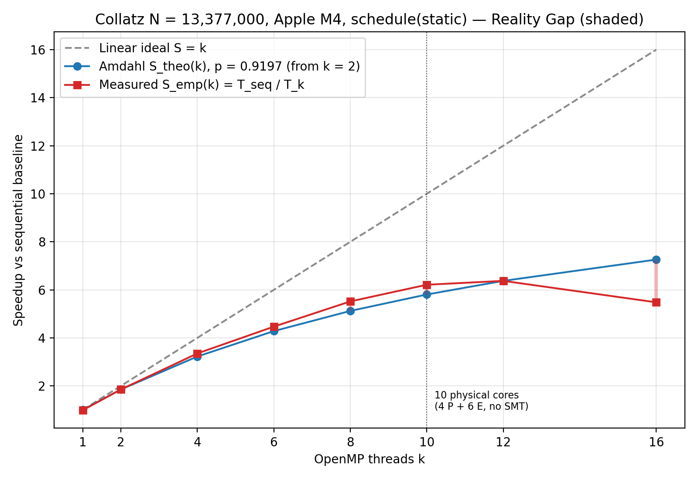

# The Amdahl Reality Gap: Collatz Speedup, False Sharing and Loop Scheduling in OpenMP

| Worksheet field | Value |
|---|---|
| Student full name | Akbota Kutushova |
| Student ID number | 230103377 |
| Institutional email / Git URL | 230103377@sdu.edu.kz / github.com/akbtdm/CSS314_230103377_Akbota (folder `week4_amdahl_openmp/`) |
| Practicum date & time | 2026-11-27, benchmarks run 14:35:56 to 14:36:26 (+05), see `logs/run_timestamp.txt` |
| Laptop model & OS | Apple MacBook Pro (Mac16,1), macOS 15.5 (24F74), Darwin 24.5.0 |
| CPU model & generation | Apple M4 (ARM64), `machdep.cpu.brand_string` |
| Physical cores (P/E) | 10 = **4 Performance + 6 Efficiency** (`hw.perflevel0/1.physicalcpu`) |
| Logical SMT threads (`omp_get_max_threads`) | **10** (no SMT on Apple silicon; `omp_get_num_procs` = 10, printed in every log) |
| Target workload size N | N = 10,000,000 + (3377 x 1,000) = **13,377,000** |
| L1 / L2 cache line size | **128 bytes** (`hw.cachelinesize`), not 64. L1d 128 KB per P-core / 64 KB per E-core; L2 16 MB (P-cluster) / 4 MB (E-cluster); no L3 reported |
| Compiler | Apple clang 17.0.0, `-O2 -Xpreprocessor -fopenmp`, Homebrew libomp 23.1.6 (`logs/build.txt`, zero warnings with `-Wall -Wextra`) |

**Verification checksum (anti-AI seed):** for N = 13,377,000 the sum of all stopping times mod 1,000,000,007 = **117349995**; the maximum stopping time is **688** (at n = 11,200,681). Every sequential and parallel run, every thread count and every schedule printed the same checksum and maximum (see `logs/`).

I measured every number in this report on this laptop on 2026-11-27, one benchmark at a time with nothing else running. The code was written with AI help, which the instructor allows; all timings come from the logs in this folder. Anything that is background knowledge, not a measurement, is labelled as such.

## Files

| File | Purpose |
|---|---|
| `hw_info.txt` | Worksheet Step 1.1, verbatim output of `sysctl -a \| grep -E "machdep.cpu\|hw.ncpu\|hw.l"` |
| `logs/hw_info_extra.txt` | Extra probes: P/E split, per-cluster caches, `hw.cachelinesize`, OS and compiler versions |
| `collatz_seq.c` | Phase 2 sequential baseline (Step 2.1), 3 runs, `omp_get_wtime()` |
| `collatz.c` | Phases 3 and 4: thread scaling, Experiment A (false sharing), Experiment B (scheduling). Compile line in its header |
| `build.sh` | Compiles both programs (`-O2 -Wall -Wextra`, OpenMP) |
| `run_all.sh` | Runs everything one at a time and `tee`s console output into `logs/` |
| `analyze.py` | Reads `results.csv`, computes p, S_theo, Delta, ratios; writes `results/tables.md` and `speedup_plot.png` |
| `results.csv` | Raw timings for Tables 1-3 (run 1 cold, run 2, run 3, average, checksum, hits, thread finish spread) |
| `speedup_plot.png` | k vs S_emp(k), S_theo(k) and linear ideal (200 dpi) |
| `results/tables.md` | Tables generated from `results.csv` (copied into this README) |
| `logs/phase2_seq.txt`, `logs/phase3_scaling.txt`, `logs/phase4a_false_sharing.txt`, `logs/phase4b_scheduling.txt` | Console output of the runs used in the tables |
| `logs/supp_ecore_seq.txt` | Supplement: sequential run forced onto E-cores (`taskpolicy -b`) |
| `logs/attempt1_spread_hidden_by_reduction/` | First full run, kept for honesty (see Deviations) |
| `lab1_230103377.tar.gz` | Submission archive in the worksheet's format (Phase 6) |

Reproduce:
```sh
brew install libomp      # Apple clang ships without an OpenMP runtime
./build.sh | tee logs/build.txt
./run_all.sh             # about 30 s in total
python3 analyze.py | tee logs/analyze.txt
```

Method (all phases): each configuration runs 3 times inside one process. Run 1 is the cold warm-up and is discarded; the reported time is (run 2 + run 3) / 2 (worksheet Step 2.2). Timing uses `omp_get_wtime()`. Each thread also stores the moment it finished its share of the loop (`nowait`), so **thread finish spread** = latest minus earliest finish = how long the fastest thread sat idle at the final barrier. That is my direct measure of load imbalance.

---

## Phase 2: Sequential baseline

Source: `logs/phase2_seq.txt`.

| Run | Time (s) |
|---|---|
| Run 1 (cold, discarded) | 1.5498 |
| Run 2 | 1.5018 |
| Run 3 | 1.5217 |
| **T_seq = (Run 2 + Run 3) / 2** | **1.5117** |

## Phase 3: Table 1, multi-thread scaling and Amdahl fitting

Source: `logs/phase3_scaling.txt`. Loop: `#pragma omp for` with the default static schedule (each thread gets one contiguous block of N/k numbers). S_emp(k) = T_seq / T_k.

Derivation of p from the dual-thread speedup:
- S_emp(2) = 1.5117 / 0.8166 = **1.8514**
- p = 2 x [1 - 1 / S_emp(2)] = 2 x [1 - 0.5401] = **0.9197**, so the apparent sequential part is 1 - p = 0.0803
- S_theo(k) = 1 / [(1 - p) + p / k], Delta(k) = S_theo(k) - S_emp(k)

| Threads (k) | Run 1 cold (s) | Run 2 (s) | Run 3 (s) | Avg T_k (s) | S_emp(k) | S_theo(k) | Delta(k) | Thread finish spread (s) |
|---|---|---|---|---|---|---|---|---|
| k = 1 (T_1) | 1.5672 | 1.5336 | 1.5320 | 1.5328 | 0.986 | 1.000 | +0.014 | 0.0000 |
| k = 2 | 0.8077 | 0.8403 | 0.7928 | 0.8166 | 1.851 | 1.851 | +0.000 | 0.0662 |
| k = 4 | 0.4472 | 0.4480 | 0.4542 | 0.4511 | 3.351 | 3.224 | -0.128 | 0.0569 |
| k = 6 (extra) | 0.3398 | 0.3392 | 0.3376 | 0.3384 | 4.468 | 4.281 | -0.186 | 0.0461 |
| k = 8 | 0.2736 | 0.2743 | 0.2737 | 0.2740 | 5.517 | 5.122 | -0.396 | 0.0482 |
| k = 10 (max physical) | 0.2489 | 0.2361 | 0.2506 | 0.2434 | 6.211 | 5.805 | -0.406 | 0.0558 |
| k = 12 (extra, oversubscribed) | 0.2315 | 0.2336 | 0.2409 | 0.2372 | 6.373 | 6.372 | -0.000 | 0.1092 |
| k = 16 (oversubscribed) | 0.2348 | 0.2759 | 0.2759 | 0.2759 | 5.479 | 7.258 | +1.779 | 0.1470 |

(Run 2 and run 3 at k = 16 agree to 4 decimals by coincidence: the log shows 0.275892 s and 0.275910 s.)



What the table shows:
- **k = 1:** the OpenMP build on one thread is 1.4% slower than the plain loop (1.5328 s vs 1.5117 s). That is the fork/join and scheduling overhead with no parallelism at all.
- **k = 2 to 10:** the measured speedup is *above* the Amdahl curve (Delta < 0). The p from k = 2 underestimates the real parallel fraction (see Q3).
- **k = 10:** best speedup on physical cores is **6.21x**, far below the linear 10x, because 6 of the 10 cores are slower E-cores.
- **k = 16:** with more threads than cores, speedup falls to **5.48x** while Amdahl predicts 7.26x; the gap is +1.78.
- A supplementary least-squares fit of Amdahl's law to k = 1..10 gives p_fit = 0.9333 (`logs/analyze.txt`). This is an extra, not the worksheet's method.

## Phase 4, Experiment A: Table 2, false sharing penalty

Source: `logs/phase4a_false_sharing.txt`. Task: also count numbers with more than 100 steps. All variants run with **10 threads** (maximum physical) and the same static schedule. All four found **10,794,097** hits (80.7% of N), so every increment really happens. Throughput = N / T. Penalty ratio = T / T(reduction).

| Implementation variant | Thread count | Run 1 cold (s) | Run 2 (s) | Run 3 (s) | Execution time (s) | Effective throughput (iter/s) | Speedup penalty ratio |
|---|---|---|---|---|---|---|---|
| Variant 1: naive `hit_count[omp_get_thread_num()]++` (false sharing) | Max physical: 10 | 0.3321 | 0.3315 | 0.3262 | **0.3289** | 40,677,502 | **1.344x** |
| Variant 2a: `reduction(+:total_hits)` | Max physical: 10 | 0.2556 | 0.2475 | 0.2420 | **0.2447** | 54,658,004 | 1.000x (reference) |
| Variant 2b: worksheet padded struct, 64 B (`int count; char pad[60];`) | Max physical: 10 | 0.2561 | 0.2648 | 0.2630 | 0.2639 | 50,691,576 | 1.078x |
| Variant 2c: padded struct, 128 B (M4 line size) | Max physical: 10 | 0.2502 | 0.2464 | 0.2533 | 0.2498 | 53,540,767 | 1.021x |

The naive array costs 0.3289 - 0.2447 = 0.084 s more. Each thread did about 1.08 million increments (10,794,097 / 10), so that is about 78 ns extra per increment per thread (derived from the measured times). That is the cost of a cache-line miss to another core, not of an `int` add. The worksheet's 64-byte padding removes only part of the penalty on this CPU (1.078x): with a 128-byte line, two padded counters still share each line. Padding to 128 bytes is within 2.1% of the reduction.

## Phase 4, Experiment B: Table 3, loop scheduling and workload imbalance

Source: `logs/phase4b_scheduling.txt`. 10 threads, same kernel; the schedule is set with `omp_set_schedule()` and `schedule(runtime)`. The first five rows are the worksheet's; the last five are extra chunk sizes I added to find the cross-over.

| OpenMP scheduling clause | Chunk size | Execution time (s) | Thread finish spread (s) | Observed behaviour and CPU load distribution |
|---|---|---|---|---|
| `schedule(static)` | Default (N/k = 1,337,700) | 0.2495 | 0.0571 | Baseline. Thread 0 gets the smallest numbers (shortest trajectories), and P-cores finish their equal share sooner than E-cores; fast threads idle 57 ms at the barrier. |
| `schedule(static, 1000)` | 1,000 | 0.2453 | 0.0355 | Round-robin interleaving evens out the *work* per thread, but static cannot adapt to *core speed*: 35 ms idle remains. |
| `schedule(dynamic, 100)` | 100 | 0.2360 | 0.0000 | Perfect balance, but 133,770 queue grabs; the grabs cost more time than the balance saves compared with chunk 1,000. |
| `schedule(dynamic, 10000)` | 10,000 | 0.2245 | 0.0013 | Near-perfect balance with only 1,338 grabs; among the fastest. |
| `schedule(guided)` | Exponential decay | 0.2287 | 0.0001 | Big chunks first, small at the end: balanced, few grabs, close to the best. |
| `schedule(dynamic, 1)` (extra) | 1 | **0.7200** | 0.0000 | 13.4 million atomic grabs on one shared counter: **3.2x slower** than chunk 1,000. Contention dominates. |
| `schedule(dynamic, 10)` (extra) | 10 | 0.2372 | 0.0000 | Still pays for 1.34 million grabs. |
| `schedule(dynamic, 1000)` (extra) | 1,000 | **0.2240** | 0.0002 | Fastest measured configuration. |
| `schedule(dynamic, 100000)` (extra) | 100,000 | 0.2276 | 0.0142 | Only 134 chunks: the last chunks start leaving threads idle (14 ms). |
| `schedule(dynamic, 1000000)` (extra) | 1,000,000 | 0.2938 | 0.1286 | 14 chunks for 10 threads: the tail is a single chunk, 129 ms idle. Worse than static. |

---

## Phase 5: Technical analysis and defense questions

### Q1: Micro-architectural root cause of false sharing

The naive variant was **1.344x slower** than the reduction (0.3289 s vs 0.2447 s) at 10 threads, and its throughput fell from 54.7 to 40.7 million iterations per second. The counters `int hit_count[64]` are 4 bytes each, so all 10 live counters (40 bytes) fit inside one or two cache lines. On this M4 the cache line is **128 bytes** (`hw.cachelinesize`), so the 64-byte example in the worksheet does not describe this CPU.

Coherence (general background, not measured here): caches keep lines coherent with a MESI-family protocol. To execute `hit_count[tid]++` a core must hold the line in the Modified (or Exclusive) state. When another core then writes *its own* counter in the same line, it sends an invalidation, the first core's copy becomes Invalid, and the line (with its dirty data) moves to the writer. With 10 threads each writing about 80% of the time, the one line keeps moving between cores. Apple silicon has no shared front-side "bus"; the invalidations and transfers go over the on-chip coherence fabric: inside a cluster through the shared L2, and between the P-cluster and E-cluster through the fabric beyond L2. The threads never share data logically, only physically through the line.

My measurements back this up:
- The extra time is about **78 ns per increment per thread**, the scale of a cross-core cache miss rather than a 1-cycle add.
- 64-byte padding (worksheet struct) still put 2 counters on each 128-byte line, and kept part of the penalty: **1.078x**.
- 128-byte padding put each counter on its own line: **1.021x**.
- The reduction keeps a private counter in a register for each thread and combines them once at the end: **1.000x**.

The penalty is moderate, not catastrophic, because each increment comes after a whole Collatz trajectory (up to 688 steps) of register-only work. Shared-line writes are a small part of the instruction stream.

### Q2: SMT saturation and physical core ceilings

The M4 has **no SMT**: `hw.logicalcpu` = `hw.physicalcpu` = 10 and `omp_get_max_threads()` = 10. So "physical to logical" does not exist here; above 10 threads the OS time-slices several threads on one core (oversubscription).
- **12 threads:** 6.37x, a little better than 10 threads (6.21x). The 12 smaller static blocks gave the OS scheduler more freedom to move work, even though the finish spread doubled to 109 ms.
- **16 threads:** speedup fell to **5.48x** (T = 0.2759 s vs 0.2434 s at 10). Static gives each thread 1/16 of the work, but 16 threads on 10 cores means some threads wait for a time slice and finish late (spread 147 ms).

Scaling was also not linear *up to* 10 threads, because the cores are not equal. Running the sequential program at background QoS, which macOS keeps on the E-cores, took **6.28 s** vs **1.51 s** on a P-core (`logs/supp_ecore_seq.txt`). Caveat: background QoS may also lower the clock, so this overstates the gap at normal priority. Even so, it shows clearly that 4 P + 6 E is worth far less than 10 P-cores. The measured 6.2x at 10 threads is consistent with that.

What SMT threads share (background knowledge, not measurable on this CPU): on SMT cores such as Intel Hyper-Threading, two hardware threads share one core's execution ports/ALUs and FPUs, the front-end (fetch/decode, micro-op cache), the reorder buffer and scheduler, the branch predictor, the L1I/L1D caches and TLBs, and the L2. Only the architectural registers are duplicated, so a compute-bound kernel like Collatz usually gains little from the second thread.

### Q3: Empirical vs. theoretical Amdahl discrepancy

From k = 2 I derived **p = 0.9197** (1 - p = 0.0803). The two curves split in two ways:

1. **For k = 4 to 10, the measurement beats the theory** (Delta from -0.13 to -0.41). The 8% "serial fraction" is not really serial code. At k = 2 static scheduling gives thread 0 the numbers 1..6.69M and thread 1 the numbers 6.69M..13.38M; larger numbers have longer trajectories, so thread 0 idled **66 ms** of the 817 ms run (finish spread). Amdahl's formula counts that idle time as sequential work. With more threads the imbalance grows more slowly than the run time shrinks, so the real curve rises above the projection. The least-squares p over k = 1..10 is higher (0.9333).
2. **Beyond 10 threads, the measurement falls far below the theory** (Delta = +1.78 at k = 16). Amdahl assumes k identical processors; at 16 threads there are only 10 cores, and 4 of them are much faster than the other 6.

Physical factors that Amdahl's equation leaves out, each seen in my data:
- **Heterogeneous core speed (P vs E):** equal work does not mean equal time. Even interleaved `static,1000` left 35 ms of idle time, and 10 threads gave 6.2x, not about 10x.
- **Load imbalance and barrier idle time:** spread of 46 to 66 ms with static scheduling. It disappears with dynamic or guided scheduling (≤1.3 ms), which made the 10-thread loop 10% faster (0.2245 s vs 0.2495 s).
- **Runtime overhead:** fork/join costs 1.4% at k = 1; work-queue contention made `dynamic,1` 3.2x slower.
- **Oversubscription and OS time-slicing:** above 10 threads.

Memory bandwidth is *not* a factor here: the kernel works entirely in registers, so I make no bandwidth claim. Clock-frequency changes as more cores become active are possible, but I did not measure them.

### Q4: The scheduling trade-off

At 10 threads, `static` took 0.2495 s, `dynamic,100` 0.2360 s and `dynamic,10000` 0.2245 s:
- **dynamic,10000 vs static:** both use few chunks, but dynamic lets fast P-cores take more chunks, so idle time fell from 57 ms to 1.3 ms; **10.0% faster**.
- **dynamic,100 vs dynamic,10000:** both are fully balanced (spread ≤1.3 ms), but `dynamic,100` makes 133,770 grabs on the shared queue counter instead of 1,338, and is **5.1% slower**.

On my machine, **queue contention starts to outweigh the balancing benefit below a chunk size of about 1,000**. The minimum is 1,000 to 10,000 (0.2240 to 0.2245 s). Below that, times rise: chunk 100 = 0.2360 s, chunk 10 = 0.2372 s, and chunk 1 = 0.7200 s (3.2x worse, 13.4 million atomic operations on one cache line, which is itself a coherence hot spot). Above that, chunks get too coarse to balance: 100,000 = 0.2276 s (14 ms idle) and 1,000,000 = 0.2938 s (129 ms idle, slower than static). `guided` (0.2287 s) gets close to the best without tuning.

---

## Phase 6: Packaging

`lab1_230103377.tar.gz` follows the worksheet format: folder `lab1_230103377/` with `hw_info.txt`, `collatz.c`, `results.csv` and `speedup_plot.png`, plus `collatz_seq.c` and this `README.md` as the written defense (Q1 to Q4). Integrity listing (`tar -tvf`): `logs/archive_listing.txt`. The archive is committed in the repository, which is the "push to a Git repository" option.

## Deviations and notes

- **Compiler:** the worksheet compiles with `gcc -O2 -fopenmp`. On macOS, `gcc` is Apple clang without OpenMP, so I used `clang -O2 -Xpreprocessor -fopenmp` with Homebrew libomp 23.1.6. I first tried the older libomp 14 bundled with Anaconda; it failed to link (`___kmpc_dispatch_deinit` missing, needed by clang 17 for `schedule(runtime)`), so I switched to Homebrew libomp.
- **Cache line is 128 bytes,** not 64. I ran the worksheet's 64-byte padded struct *and* a 128-byte one, to show the difference.
- **Thread counts:** the worksheet asks for k = 1, 2, 4, 8, 16. I also ran k = 6, 10 (= max physical, used for Experiments A and B) and 12.
- **Reductions written by hand for timing:** in the final code, the checksum sum and max are added up in private variables and merged in a `critical` section after each thread records its finish time. In my first full run (`logs/attempt1_spread_hidden_by_reduction/`), I used `reduction(+:sum) reduction(max:mx) nowait`. libomp's tree reduction for teams of 8 or more adds a barrier, which hid the per-thread spread (it read ~0 s at k ≥ 8). Total times of the two runs agree within about 5% for k ≤ 10, in Experiment A (naive penalty there was 1.37x) and in 9 of 10 Experiment B rows; the exceptions are the oversubscribed k = 16 (0.2368 s vs 0.2759 s) and `dynamic,100000` (0.2486 s vs 0.2276 s). The Q4 conclusion (chunk 1,000 to 10,000 fastest, chunk 100 and below slower) holds in both runs. Variant 2a still uses a real `reduction(+:total_hits)` clause, as the worksheet asks, so its spread column is not meaningful.
- **No thread pinning:** libomp does not support thread affinity on macOS, so the OS decides which threads run on P- or E-cores. This is part of the run-to-run variance (for example k = 2, run 2 = 0.8403 s vs run 3 = 0.7928 s).
- **Not done here:** no PDF `analysis.pdf` (the worksheet allows written answers instead; they are in this README). Nothing was uploaded anywhere; the repository was not pushed.
