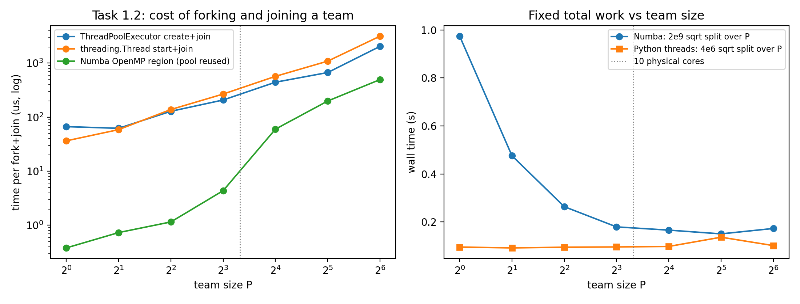
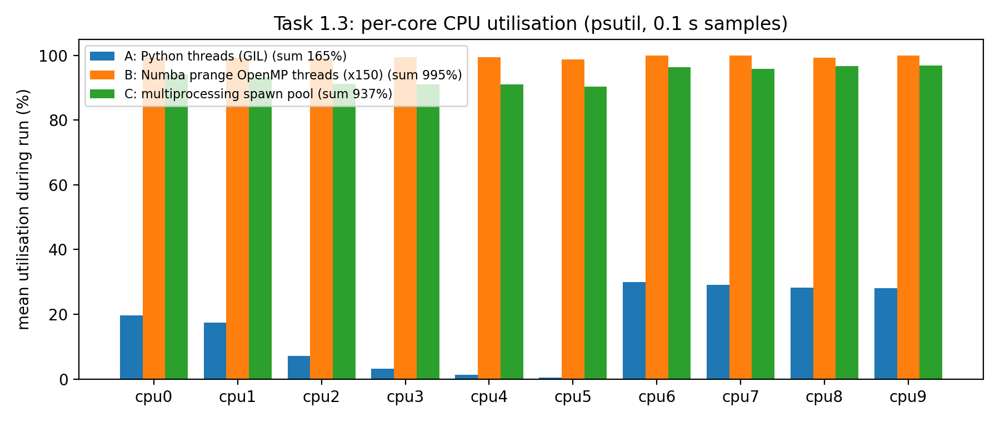
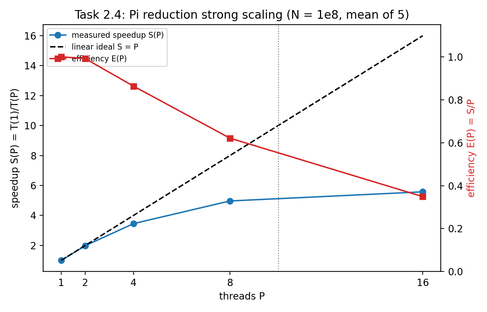
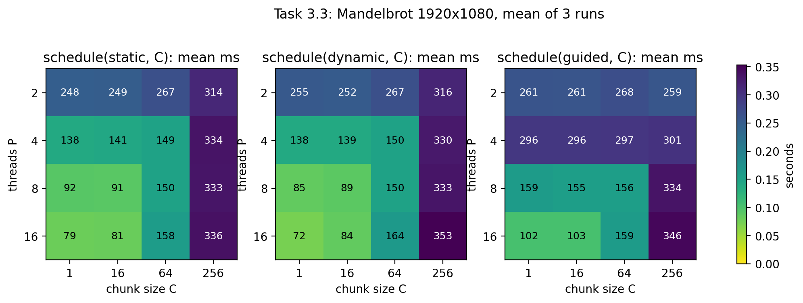
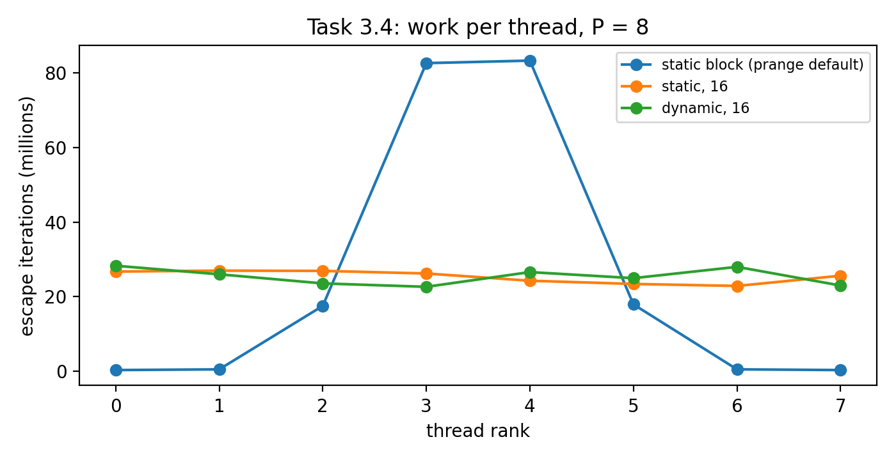
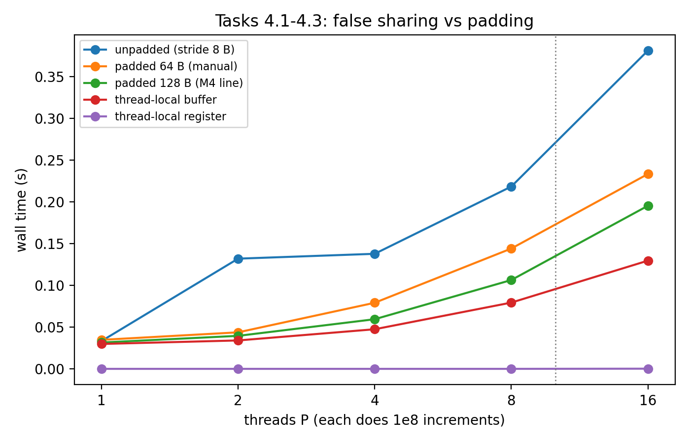
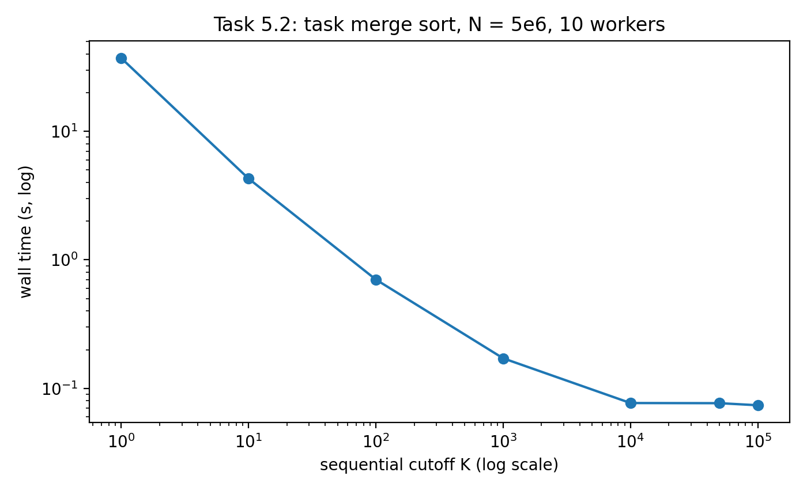
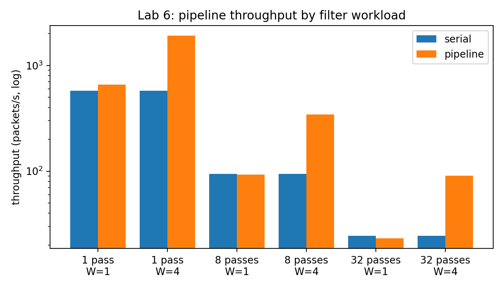

**Course:** High-Performance & Parallel Computing, Lab Practice Manual: OpenMP Paradigms (instructor Sufyan bin Uzayr)
**Repository:** github.com/akbtdm/CSS314_230103377_Akbota, folder `week4_openmp_practice_manual/`
**Edition:** Python (Numba OpenMP threading layer for real parallel threads; CPython threads and multiprocessing for comparison)

Every number in this report was measured on the laptop described in Section I on 27 Nov 2026 (full run 14:58:04 to 15:00:41, `logs/run_timestamp.txt`), one benchmark at a time with nothing else running. The raw console output is in `logs/`, the raw data in `results/*.csv`, and every plot is generated from those CSV files by `make_plots.py`. The code was written with AI assistance, which the instructor allows. Statements marked *(background)* are textbook or documentation knowledge, not measurements.

# Section I: System & Hardware Specifications

Source: `logs/hw_info.txt` (output of `hw_info.sh`).

| Item | Value |
|---|---|
| Machine | Apple MacBook Pro, `hw.model` = Mac16,1 |
| CPU model | Apple M4 (ARM64) |
| Physical cores | 10 = 4 Performance + 6 Efficiency |
| Logical hardware threads | 10 (no SMT / Hyper-Threading on Apple silicon) |
| L1 data cache | 128 KB per P-core, 64 KB per E-core (L1i 192 KB / 128 KB) |
| L2 cache | 16 MB shared by the 4 P-cores, 4 MB shared by the 6 E-cores |
| L3 cache | not reported by `sysctl` (no L3 is exposed by macOS) |
| Cache line size | **128 bytes** (`hw.cachelinesize`), not the 64 bytes the manual assumes |
| RAM | 16 GB |
| OS | macOS 15.5 (24F74), Darwin 24.5.0 |
| Python | CPython 3.13.5 (Anaconda), GIL enabled, multiprocessing start method `spawn` |
| Libraries | NumPy 2.1.3, Numba 0.61.0 (threading layer **omp**, a real OpenMP runtime), psutil 5.9.0, matplotlib 3.10.0 |

Thread affinity: macOS has no API to pin a thread to a core, so the OS decides whether a thread runs on a P-core or an E-core. This matters for several results below.

# Section II: Experimental Methodology

* **Parallel runtime.** CPython 3.13 has a Global Interpreter Lock, so plain `threading` threads never execute Python bytecode at the same time. Wherever the manual expects real parallel threads I used Numba `@njit(parallel=True)` with `prange`, `numba.set_num_threads(P)` (= `omp_set_num_threads`) and `numba.get_thread_id()` (= `omp_get_thread_num`), with `NUMBA_THREADING_LAYER=omp`. `prange(P)` over thread ranks is the equivalent of `#pragma omp parallel num_threads(P)`.
* **Missing directives.** Numba has no `atomic`, `critical` or `schedule(dynamic)`. `common/omp_numba.py` emits the LLVM instructions directly: atomic fetch-add, atomic float add, compare-and-swap (used for a spin lock = `critical`, and for `guided`), and a *racy* add made of a relaxed load, an add and a relaxed store (plain `ldr / add / str` on ARM64, the same as `volatile` in C; I checked the generated assembly). Without it LLVM keeps the counter in a register and neither the race nor false sharing would appear.
* **Timer.** `time.perf_counter()` (monotonic, nanosecond resolution) around each call, measured from Python.
* **Warm-up.** Every Numba function is JIT-compiled on a small input before timing, and each configuration is run once at its thread count before the timed trials (Lab 2.3, Lab 3, Lab 4). The first call at a new thread count is reported separately in Lab 1.
* **Trials.** Lab 1.2: 20 repetitions (Python teams) / 200 (Numba regions) averaged, fixed-work test 3 trials. Lab 2.1: 3 trials per P. Lab 2.2: mean of 5 (Numba) / 3 (CPython). Lab 2.3: 5 trials, mean and standard deviation. Lab 3: 3 runs per cell. Lab 4: 3 trials. Lab 5: 3 trials (1 trial for K = 1 and K = 10, which take seconds each). Lab 6: one run per configuration of 120 packets.
* **Correctness checks.** Lab 3 asserts that every scheduled render produces the same image and the same total iteration count as the serial render. Lab 4 asserts every counter reached its target. Lab 5 asserts the output is sorted and equals `np.sort`. Lab 6 asserts the pipeline results equal the serial results.
* Everything is run by `run_all.sh` (about 2 min 40 s in total); `make_plots.py` rebuilds all figures.

# Section III: Empirical Results & Visualizations

## Lab 1: Fork-join model, team creation and thread scoping

**Task 1.1 (non-determinism).** The manual's starter (`lab1/starter_fork_join.py`) was run 10 times (`logs/lab1_task1_1_nondeterminism.txt`). All 10 runs printed the ranks in the same order 0, 3, 1, 2. The starter sleeps `0.001 * (rank % 3)` seconds, so ranks 0 and 3 sleep 0 ms, rank 1 sleeps 1 ms and rank 2 sleeps 2 ms: the sleeps force the order. In every run rank 1 also printed the same native OS thread ID as rank 0, because the `ThreadPoolExecutor` reused the thread that had already finished rank 0. To see the scheduler's own non-determinism, I also ran an 8-thread Numba/OpenMP team 10 times. Each thread takes a ticket with an atomic fetch-and-add, which records the order in which the threads arrive (`logs/lab1_task1_1_numba_team.txt`):

| Run | Arrival order of ranks (rank = OpenMP thread id) |
|---|---|
| 1 | 0 4 3 2 1 7 6 5 |
| 2 | 0 3 2 1 7 4 6 5 |
| 3 | 0 4 2 3 6 1 7 5 |
| 4 | 0 3 2 4 7 6 1 5 |
| 5 | 0 3 2 4 7 6 1 5 |
| 6 | 0 3 4 2 1 6 7 5 |
| 7 | 4 3 0 2 1 6 7 5 |
| 8 | 0 3 4 1 7 2 5 6 |
| 9 | 0 4 2 3 7 6 1 5 |
| 10 | 0 3 4 2 7 6 1 5 |

The 10 runs produced 9 different orders. The master (rank 0) arrived first in 9 of them, because it is already running when the region starts, while the workers have to be woken up.

**Task 1.2 (oversubscription sweep).** `logs/lab1_task1_2_sweep.txt`, `results/lab1_oversubscription.csv`.

| P | ThreadPoolExecutor create+join (us) | threading.Thread start+join (us) | Numba region, first call (us) | Numba region, reused pool (us) | Numba fixed work 2e9 sqrt (s) | Python threads fixed work 4e6 sqrt (s) |
|---|---|---|---|---|---|---|
| 1 | 66.9 | 36.5 | 4.8 | 0.38 | 0.9744 | 0.0950 |
| 2 | 62.3 | 58.8 | 56.5 | 0.73 | 0.4757 | 0.0914 |
| 4 | 128.5 | 138.7 | 24.0 | 1.15 | 0.2635 | 0.0944 |
| 8 | 208.0 | 267.9 | 57.0 | 4.37 | 0.1790 | 0.0953 |
| 16 | 443.7 | 569.9 | 110.4 | 60.06 | 0.1655 | 0.0976 |
| 32 | 670.5 | 1089.2 | 211.1 | 199.30 | 0.1500 | 0.1361 |
| 64 | 2045.6 | 3156.8 | 870.1 | 496.55 | 0.1725 | 0.1011 |

Creating and joining OS threads costs about 30 to 50 us per thread. A reused OpenMP pool costs under 5 us up to P = 8 and then jumps 14x, to 60 us, at P = 16, as soon as there are more threads than the 10 cores. With a fixed amount of real work (Numba), time falls from 0.974 s to 0.179 s at P = 8 (5.4x) and changes little after that (0.150 s at P = 32, 0.173 s at P = 64). The Python-thread version stays at about 0.09 to 0.14 s for every P because of the GIL.

**Task 1.3 (CPU saturation).** Each of 10 threads computes 10,000,000 square roots. Activity Monitor cannot be screenshotted from this environment, so a `psutil` sampler recorded per-core utilisation every 0.1 s instead (`logs/lab1_task1_3_saturation.txt`, `results/lab1_cpu_saturation*.csv`). The Numba region takes only about 9 ms, so it was repeated 150 times to give the sampler something to see.

| Variant | Wall (s) | Sum of per-core utilisation | Cores busy |
|---|---|---|---|
| A: 10 CPython threads (GIL) | 2.248 | 164.6 % | 1.65 |
| B: 10 Numba OpenMP threads (x150 repetitions) | 1.353 | 994.6 % | 9.95 |
| C: 10-process `multiprocessing` pool (spawn) | 1.162 | 937.0 % | 9.37 |

## Lab 2: Pi integration, race conditions, critical sections and reductions

**Task 2.1 (naive race, N = 100,000,000).** `logs/lab2_pi.txt`, `results/lab2_race.csv`.

| P | Pi trial 1 | Pi trial 2 | Pi trial 3 | Mean absolute error | Mean time (s) |
|---|---|---|---|---|---|
| 1 | 3.141592653590 | 3.141592653590 | 3.141592653590 | 6.3e-13 | 0.0909 |
| 2 | 1.593087005838 | 1.503801687472 | 1.507449835296 | 1.607 | 0.0387 |
| 4 | 0.909498080916 | 0.893735968874 | 0.939263671816 | 2.227 | 0.0224 |
| 8 | 0.590766921281 | 0.621694720980 | 0.650701479298 | 2.521 | 0.0237 |

Comparison: the same unprotected `shared[0] += term` written with CPython threads (N = 2,000,000) gave error 2.0e-13, 6.4e-14, 1.8e-13 and 2.1e-13 for P = 1, 2, 4 and 8, which matches the serial result (2.0e-13). The GIL hid the race completely in this test.

**Task 2.2 (critical section, N = 1,000,000).** Overhead = (T - T_serial) / T_serial. `results/lab2_critical.csv`.

| Implementation | P = 1 | P = 2 | P = 4 | P = 8 |
|---|---|---|---|---|
| Numba serial baseline | 0.873 ms | | | |
| Numba `critical` (CAS spin lock) | 1.155 ms (+32 %) | 39.13 ms (+4,385 %) | 96.22 ms (+10,927 %) | 234.51 ms (+26,778 %) |
| Numba `atomic` (atomic float add) | 3.618 ms (+315 %) | 5.491 ms (+529 %) | 16.32 ms (+1,770 %) | 130.59 ms (+14,867 %) |
| CPython serial baseline | 32.78 ms | | | |
| CPython `threading.Lock` | 109.1 ms (+233 %) | 105.7 ms (+222 %) | 107.6 ms (+228 %) | 108.2 ms (+230 %) |

All of these variants gave the correct value of Pi. With 8 threads, the Numba critical section is 269 times slower than the serial loop.

**Tasks 2.3 and 2.4 (reduction strong scaling, N = 100,000,000, 5 trials).** `results/lab2_scaling.csv`. The serial `@njit` loop with no `prange` took 0.0880 s. T(1) below is the `prange` reduction run with 1 thread, which is faster (0.0559 s), probably because the parallel version is compiled differently.

| P | Mean T(P) (s) | Std dev (s) | Speedup S(P) | Efficiency E(P) | Pi |
|---|---|---|---|---|---|
| 1 | 0.05591 | 0.00059 | 1.00 | 1.00 | 3.141592653590 |
| 2 | 0.02820 | 0.00028 | 1.98 | 0.99 | 3.141592653590 |
| 4 | 0.01619 | 0.00144 | 3.45 | 0.86 | 3.141592653590 |
| 8 | 0.01126 | 0.00041 | 4.97 | 0.62 | 3.141592653590 |
| 16 | 0.01003 | 0.00046 | 5.58 | 0.35 | 3.141592653590 |

## Lab 3: Loop scheduling on the Mandelbrot set

The image is 1920 x 1080 with MAX_ITER = 1000. The serial render takes 0.4902 s and performs 203,116,879 escape iterations in total. Static(C) assigns chunks round-robin, dynamic(C) uses an atomic fetch-and-add row counter, and guided(C) claims max(C, remaining/P) rows with compare-and-swap. "block" is the `prange` default from the starter (one contiguous block of rows per thread). Mean of 3 runs, in ms; imbalance = (max - min) / mean of the per-thread iteration counts (Task 3.4). Source: `results/lab3_schedule_matrix.csv`.

| Policy | P | C = 1 | C = 16 | C = 64 | C = 256 |
|---|---|---|---|---|---|
| static | 2 | 248 (0.001) | 249 (0.014) | 267 (0.105) | 314 (0.434) |
| static | 4 | 138 (0.004) | 141 (0.040) | 149 (0.131) | 334 (2.395) |
| static | 8 | 92 (0.013) | 91 (0.161) | 150 (1.927) | 333 (4.828) |
| static | 16 | 79 (0.018) | 81 (0.310) | 158 (3.941) | 336 (9.656) |
| dynamic | 2 | 255 (0.001) | 252 (0.002) | 267 (0.085) | 316 (0.431) |
| dynamic | 4 | 138 (0.010) | 139 (0.008) | 150 (0.121) | 330 (2.395) |
| dynamic | 8 | 85 (0.181) | 89 (0.190) | 150 (1.890) | 333 (4.828) |
| dynamic | 16 | **72** (0.536) | 84 (0.785) | 164 (3.962) | 353 (9.656) |
| guided | 2 | 261 (0.008) | 261 (0.008) | 268 (0.008) | 259 (0.008) |
| guided | 4 | 296 (2.058) | 296 (2.058) | 297 (2.058) | 301 (2.190) |
| guided | 8 | 159 (1.991) | 155 (1.992) | 156 (2.030) | 334 (4.828) |
| guided | 16 | 102 (2.243) | 103 (2.233) | 159 (3.952) | 346 (9.656) |

Cells show mean ms, with the load imbalance in brackets.

| Block static (prange default) | P = 2 | P = 4 | P = 8 | P = 16 |
|---|---|---|---|---|
| Mean time (ms) | 248 | 267 | 232 | 154 |
| Imbalance | 0.011 | 1.974 | 3.262 | 4.022 |

Per-thread iteration counts for block static at P = 8 (run 1): 0.38, 0.56, 17.5, **82.5, 83.2**, 18.0, 0.57 and 0.38 million. Ranks 3 and 4 do 82 % of all the work.

## Lab 4: False sharing, padding and thread-local accumulators

Each thread performs 100,000,000 increments of its own counter. The counter array starts on a 128-byte boundary. Mean of 3 trials, in seconds. Source: `logs/lab4_false_sharing.txt`, `results/lab4_false_sharing.csv`.

| P | Unpadded (8 B apart) | Padded 64 B (manual stride 8) | Padded 128 B (stride 16) | Thread-local buffer | Thread-local register |
|---|---|---|---|---|---|
| 1 | 0.0333 | 0.0347 | 0.0315 | 0.0298 | 0.0000 |
| 2 | **0.1319** | 0.0437 | 0.0395 | 0.0340 | 0.0000 |
| 4 | **0.1377** | 0.0791 | 0.0594 | 0.0474 | 0.0000 |
| 8 | **0.2182** | 0.1440 | 0.1063 | 0.0793 | 0.0000 |
| 16 | **0.3809** | 0.2332 | 0.1952 | 0.1295 | 0.0002 |

* Every thread does the same amount of work, so ideally the time would stay flat as P grows. Instead, the unpadded version is already 4.0 times slower with 2 threads (0.1319 s) than with 1 thread (0.0333 s).
* Unpadded / 128-byte padded: 3.34x at P = 2, 2.32x at P = 4, 2.05x at P = 8 and 1.95x at P = 16.
* The manual's 64-byte padding is not enough on this chip. Because the cache line is 128 bytes, two counters still share each line, and the 64-byte version is 11 % to 35 % slower than the 128-byte one at P = 2 to 8.
* The padded and buffer variants also slow down with P. Up to P = 10, the extra threads land on the slower E-cores. Above 10 cores (P = 16), threads must take turns on a core.
* The thread-local register variant takes about 0 s. LLVM turns `s += 1` repeated n times into `s = n`, which is exactly the benefit of keeping the accumulator in a register.
* **Task 4.4 (`perf stat`) was not done.** `perf` exists only on Linux. On macOS the hardware cache-miss counters need Instruments with elevated privileges, which this environment does not have. No cache-miss counts are reported, and none are invented.

## Lab 5: Task-based parallel merge sort

**Implementation.** P = 10 worker threads take tasks from a shared LIFO task queue. A split task either sorts its range (size <= K) or creates two child tasks. When the second child finishes, it enqueues the parent's merge task, which is `taskwait` written as a continuation, so no worker ever blocks. The leaf sort and the merge are Numba `nogil` kernels, so they run in parallel, while the Python scheduling code runs under the GIL. Input: 5,000,000 random int64 values in [0, 10^7), with seed 230103377.

**Task 5.1 (verification).** Every finished run passed `assert np.all(a[:-1] <= a[1:]) and np.array_equal(a, np.sort(data))`.

**Task 5.2 (cutoff sweep).** `logs/lab5_cutoff_sweep.txt`, `results/lab5_cutoff_sweep.csv`. Baselines: `np.sort` 0.1271 s; Numba serial recursive merge sort without tasks 0.5480 s.

| K | log10 K | Mean time (s) | Trials | Tasks executed |
|---|---|---|---|---|
| 1 | 0.00 | 37.2126 | 1 | 14,999,998 |
| 10 | 1.00 | 4.2962 | 1 | 1,572,862 |
| 100 | 2.00 | 0.7032 | 3 | 196,606 |
| 1,000 | 3.00 | 0.1714 | 3 | 24,574 |
| 10,000 | 4.00 | 0.0769 | 3 | 1,534 |
| 50,000 | 4.70 | 0.0767 | 3 | 382 |
| 100,000 | 5.00 | **0.0739** | 3 | 190 |

The manual's own process-pool starter (pure-Python lists, N = 1,000,000, cutoff 50,000) took **3.2179 s**, compared with 1.4397 s for the sequential pure-Python merge sort in the same process. With the `spawn` start method, starting processes and pickling the lists costs more than the parallelism saves (`logs/lab5_starter_process_pool.txt`).

**Task 5.3 (Work-Span).** *Theory (background):* T1 = Theta(N log N). With a sequential merge, the span is T_inf = Theta(N): the merges along one root-to-leaf path cost N + N/2 + N/4 + ... < 2N. The parallelism is therefore T1 / T_inf = Theta(log N), which is about log2(5x10^6) = 22 in a unit-cost model.
*Measurement:* every task timed itself, and the longest root-to-leaf path was computed over the actual task DAG (K = 50,000, so 128 leaves and 127 merges; `results/lab5_workspan.csv`):

| Workers | Wall (s) | Work T1 = sum of task times (s) | Span T_inf = longest path (s) | T1 / T_inf |
|---|---|---|---|---|
| 1 | 0.3342 | 0.3335 | 0.0383 | **8.70** |
| 10 | 0.0746 | 0.4182 | 0.0461 | 9.07 |

Mean merge time per tree level (10-worker run): 18.44 ms for the root merge of 5,000,000 elements, 9.75 ms (2.5 M), 6.10 ms (1.25 M), 2.86 ms, 1.59 ms, 0.77 ms and 0.43 ms (78,125). The merges on the critical path add up to 39.9 ms, so almost the whole span is sequential merging. The measured speedup with 10 workers is 0.3342 / 0.0746 = 4.48x, below the measured parallelism of 8.7.

## Lab 6 (Bonus): 3-stage pipeline

120 packets of 512 x 512 float64 values pass through the pipeline, with bounded `queue.Queue(maxsize=8)` queues between stages. Stage 2 applies a 5 x 5 Gaussian blur, `passes` times, using W worker threads. Shutdown uses one sentinel per worker. Source: `logs/lab6_pipeline.txt`, `results/lab6_pipeline.csv`.

| Passes | W | Pipeline (s) | Throughput (pkt/s) | Serial (pkt/s) | Latency mean / p95 (ms) | q1 occupancy mean / max | q2 occupancy mean / max | Busy fraction: reader / filter per worker / writer |
|---|---|---|---|---|---|---|---|---|
| 1 | 1 | 0.183 | 656.1 | 574.7 | 14.75 / 16.48 | 7.59 / 8 | 0.00 / 0 | 0.07 / 0.98 / 0.12 |
| 1 | 4 | 0.063 | 1913.0 | 574.7 | 6.94 / 8.68 | 6.88 / 8 | 0.62 / 3 | 0.53 / 0.95 / 0.78 |
| 8 | 1 | 1.294 | 92.7 | 94.1 | 104.09 / 119.70 | 7.75 / 8 | 0.00 / 0 | 0.01 / 0.99 / 0.02 |
| 8 | 4 | 0.349 | 344.1 | 94.1 | 36.23 / 43.24 | 7.65 / 8 | 0.06 / 2 | 0.08 / 0.98 / 0.15 |
| 32 | 1 | 5.177 | 23.2 | 24.5 | 414.93 / 497.65 | 7.76 / 8 | 0.00 / 1 | 0.00 / 1.00 / 0.04 |
| 32 | 4 | 1.320 | 90.9 | 24.5 | 136.69 / 164.52 | 7.77 / 8 | 0.01 / 1 | 0.02 / 0.99 / 0.04 |

Every pipeline run produced the same statistics as the serial loop.

# Section IV: Analytical & Discussion Responses

## Lab 1

**Q1.1 (Scheduling).** The OpenMP team in Task 1.1 printed 9 different arrival orders in 10 runs, because the ranks are just labels: which thread reaches the ticket counter first depends on when the OS kernel scheduler (on macOS, the XNU Mach scheduler) wakes each sleeping worker, which core it places it on, and what else that core is doing. On the M4 two more factors are at play. First, a thread placed on a P-core runs faster than one on an E-core. Second, the master is already running when the region starts, which is why rank 0 came first in 9 of the 10 runs. Inside the hardware, the cache-coherence fabric decides which core's atomic fetch-and-add on the shared ticket wins. The starter template did *not* show this: its `sleep(0.001 * (rank % 3))` imposes the order 0, 3, 1, 2, and that order appeared in all 10 runs. So a fixed order in one program proves nothing; an order that is not forced is never guaranteed.

**Q1.2 (Oversubscription).** When P exceeds the 10 cores, threads must share cores, and the OS has to context-switch between them. A context switch saves one thread's registers, stack pointer and kernel state, then restores another's. Its direct cost is microseconds, but the indirect cost is larger: the incoming thread finds L1 and L2 caches and branch predictors filled with the previous thread's data, and evicts that data in turn (cache thrashing). My measurements show this in two places:

* The reused OpenMP region costs 4.37 us at P = 8, 60 us at P = 16 and 497 us at P = 64. With more threads than cores, the end-of-region barrier must wait for threads that are not currently running.
* For a fixed amount of work, going from 8 to 64 threads brought no gain (0.179 s against 0.173 s). The small improvement at P = 16 to 32 has a different cause: with P = 10 equal shares, the 4 P-cores finish early and wait for the 6 E-cores, while many small shares let the OS move work onto the idle P-cores.

The Python-thread rows show the GIL: 4e6 square roots take about 0.09 to 0.14 s for every P, because only one thread executes bytecode at a time (Task 1.3: 1.65 cores busy against 9.95 for Numba).

**Q1.3 (Barriers).** The implicit barrier at the end of a parallel region guarantees that every thread has finished, and every write made inside the region is visible (it acts as a memory flush), before the master continues. Without it, the master could read partial results, such as a reduction variable before every thread has added to it or an image with rows still missing. It could also free or reuse buffers that workers are still writing to, or start the next phase on data that is not ready. That produces wrong results, use-after-free bugs and non-reproducible output. In my code, the end of every `prange` is this barrier (`f.result()` in the starter). In Lab 5 I replaced blocking waits with a pending-children counter per task, which provides the same guarantee for a single task.

**Q1.4 (Architectural mapping).** A *hardware thread* (SMT / Hyper-Threading) is a second register context inside one physical core that shares that core's execution units and caches. The M4 has none, so its 10 logical CPUs are 10 physical cores. An *OS kernel thread* is the unit the kernel schedules onto a hardware thread; it has its own stack and is created and switched by the kernel (Lab 1.2: about 30 to 50 us to create and join each one from Python). A *green or virtual thread* (Java virtual threads, Python asyncio tasks or greenlets) is scheduled by the language runtime onto a few kernel threads. It is very cheap to create, but it runs in parallel only if the runtime spreads it over several kernel threads; in CPython it never runs bytecode in parallel because of the GIL. OpenMP threads, and therefore Numba's, are kernel threads kept in a pool, which is why a reused region costs under 1 us at P = 1.

## Lab 2

**Q2.1 (Memory incoherency).** `shared += term` compiles to three instructions (on ARM64: `ldr d0, [x]`, `fadd d0, d0, d1`, `str d0, [x]`; I checked the same `ldr / add / str` pattern in the Lab 4 kernel assembly). If thread A loads the value S, thread B also loads S, A stores S + a and then B stores S + b, then A's update is lost. Each thread sees the line in its own cache, and nothing makes the load-add-store sequence indivisible. More threads means more overlapping windows, and in the limit each thread mostly overwrites the others. That is why the measured Pi fell to about 1.5 (P = 2), 0.9 (P = 4) and 0.6 (P = 8): roughly the share of one thread plus a little. The error grew from 1.6 to 2.5 as P went up. CPython threads did not lose any updates (error about 1e-13). The GIL is only released at specific points in the bytecode loop (backward jumps, calls), not between the load and the store of `+=`, so the race exists in principle but did not show up in 4 x 2,000,000 updates.

**Q2.2 (Reduction trees).** In a critical section, all N updates pass through one lock and one cache line. Each acquire moves the line to the next core, so the work is serialised and gets slower as P grows: in my measurements 39 ms at P = 2 and 235 ms at P = 8, against 0.87 ms serially. A reduction gives each thread a private accumulator in a register: N/P additions with no communication, then the P partial sums are combined pairwise in log2 P steps. Communication drops from N contended updates to P - 1 combinations, which is negligible here: S = 4.97 at P = 8 with the correct Pi. Even a hardware `atomic` (130.6 ms at P = 8) costs about 130 ns per term against about 0.11 ns per term for the reduction (about 1,160 times more), because it still moves one cache line around for every update.

**Q2.3 (Amdahl's Law).** With serial fraction f = 0.05, S(P) = 1 / (f + (1 - f)/P), which tends to 1/f = **20** as P grows without limit. My measured curve flattens much earlier: S(8) = 4.97 and S(16) = 5.58. Fitting Amdahl's formula to S(8) gives an apparent serial fraction e = (1/S - 1/P)/(1 - 1/P) = 0.087 (Karp-Flatt metric, derived from my numbers). But the loop has almost no serial part, so the gap comes from other factors:

1. **Heterogeneous cores.** Only 4 of the 10 cores are fast P-cores, so equal static shares finish at the pace of the E-cores. S(4) = 3.45 is already below 4, and above P = 4 the extra threads land on the slower cores.
2. **Overheads.** Waking the team and the barrier cost about 4 us at P = 8 (Lab 1) against an 11 ms region.
3. **Oversubscription.** P = 16 exceeds the 10 cores.
4. Thermal and frequency limits when all cores are active *(background)*.

**Q2.4 (Hardware primitives)** *(background, not measured)*. Each core's cache keeps a coherence state per line (MESI or a variant such as MOESI). For an atomic RMW, the core must first hold the line in the exclusive or modified state, which means sending an invalidation or read-for-ownership request over the coherence interconnect (bus snooping on small systems, a directory or snoop filter on large ones). Once it owns the line, the core performs the read-modify-write without giving the line up. Old x86 locked the whole bus (`LOCK#`); modern x86 locks only the cache line (`LOCK XADD`, `LOCK CMPXCHG`). ARM uses load-link/store-conditional (`LDXR`/`STXR`): the store fails, and the loop retries, if another core touched the line in between. ARMv8.1 also has single-instruction LSE atomics (`LDADD`, `CAS`). A floating-point atomic add, as in my `atomic` variant, has no single instruction and is built as a compare-and-swap retry loop. Under contention those retries are why it slows down sharply (5.5 ms at P = 2, 130.6 ms at P = 8).

## Lab 3

**Q3.1 (Fine-grained contention).** With C = 1, every row costs one atomic fetch-and-add on the single cache line that holds the shared counter. Under contention that line must travel between the cores' L1 caches through the coherence fabric (on the M4, between the two core clusters' L2s); that line, and the interconnect carrying it, is the contested resource. In *my* measurement C = 1 was **not** slow: dynamic,1 was the fastest cell (72 ms at P = 16). One row here costs about 0.45 ms of computation on average (490 ms / 1080 rows), so 1080 atomics of roughly 100 ns each are a negligible fraction. The penalty described in the manual appears when the work per iteration is close to the cost of moving the counter's cache line between cores. Lab 2's `atomic` variant shows this regime: about 130 ns per update at P = 8 (130.6 ms / 1,000,000) for an iteration that costs about 1 ns.

**Q3.2 (Spatial imbalance).** Rows map to y0 in [-2, 2]. The Mandelbrot set lies around the real axis (y0 = 0, the middle rows), where most pixels never escape and need all 1000 iterations. Rows near the top and bottom escape after a few iterations. With block static scheduling, the threads that own the middle blocks become the stragglers: at P = 8 ranks 3 and 4 did 82.5 M and 83.2 M iterations, while ranks 0 and 7 did 0.38 M each. At P = 4, ranks 1 and 2 did 100 M and 101 M against 0.94 M. That is why block static with P = 4 (267 ms) was *slower* than with P = 2 (248 ms). With C = 256 there are only ceil(1080/256) = 5 chunks, and the middle chunk alone takes about 330 ms for every P, so P = 2 to 16 cannot help.

**Q3.3 (Guided policy).** Guided hands out chunk = max(C, ceil(R/P)) rows, where R is the number of rows still unassigned. Chunks shrink geometrically, by a factor of about (1 - 1/P) each time, so the first claims are large and few (low overhead, like static) and the last ones are small, which lets late threads balance the tail (like dynamic). The total number of chunks is about P ln(N/(P C)) instead of N/C. Its weakness showed up clearly here. With P = 4 the first chunks are 270, 203 and 152 rows, and the third chunk (rows 473 to 624) contains the whole dense middle of the set: one thread did 109 M iterations, imbalance 2.06, 296 ms, slower than static or dynamic with small C (138 ms). Guided assumes the expensive iterations are spread evenly or come at the end. When a large early chunk is the most expensive one, guided turns into static.

**Q3.4 (Engineering heuristic).**

* **Static (block)**: when every iteration costs the same and data locality matters (stencils, dense linear algebra). It has the lowest overhead.
* **Static with a small C (round-robin)**: when the cost varies smoothly in space, as here. Interleaving spreads the expensive region evenly at no runtime cost: static,1 at P = 8 took 92 ms against 232 ms for block.
* **Dynamic with a moderate C**: when the cost is irregular or unpredictable (data-dependent loops, cores of different speeds such as P/E). Choose C so that one chunk's work is at least about 1000 times the cost of one atomic (here about 100 us or more), and so that there are at least about 10 chunks per thread for the tail.
* **Guided**: when the cost is irregular but roughly uniform in expectation, or decreases along the loop, and the trip count is large. Avoid it when the expensive iterations are concentrated early or in the middle, as in the Mandelbrot set.

## Lab 4

**Q4.1 (MESI state transitions)** *(protocol from background; the slowdown it explains is measured)*. On this M4 one 128-byte line holds 16 int64 counters (the manual's 64-byte line would hold 8). Take counters c0 to c3 in one line L, with core 0 writing c0 and core 1 writing c1:

| Step | Event | Core 0 copy of L | Core 1 copy of L |
|---|---|---|---|
| 0 | start, L only in memory | I | I |
| 1 | core 0 reads c0 | E | I |
| 2 | core 0 writes c0 | M (silent upgrade from E) | I |
| 3 | core 1 reads c1: snoop hit, core 0 supplies the line and writes it back | S | S |
| 4 | core 1 writes c1: invalidate sent to core 0 | I | M |
| 5 | core 0 writes c0: read-for-ownership, core 1 supplies the line | M | I |
| 6 | core 1 writes c1: read-for-ownership | I | M |
| ... | repeats on every write | M / I | I / M |

Each write after step 4 needs a round trip over the coherence interconnect instead of a hit in the core's own L1, even though c0 and c1 are logically independent.

**Q4.2 (Bus bouncing).** With padding or private buffers, each thread's line stays in the modified state in its own L1, and every increment is an L1 hit (0.30 to 0.35 ns at P = 1). Unpadded, the line holding all the counters moves between cores on almost every write. The bottleneck is the coherence interconnect and the latency of each ownership transfer, not compute. That is why 2 threads, each doing the same work as 1 thread, took 0.132 s instead of 0.033 s (4.0x slower), and 16 threads took 0.381 s (11.4x the single-thread time; 1.95x the padded time at the same P). On the M4 the effect is milder than textbook x86 figures *(background)*, probably because a core can keep the line for a burst of writes before the next invalidation arrives. The direction is still unambiguous, and the 64-byte padding is visibly worse than 128-byte padding (0.0791 s against 0.0594 s at P = 4) because it still puts two counters in each 128-byte line.

**Q4.3 (True vs false sharing).** *True sharing* means threads access the same variable, so communication is required by the program's logic and must be synchronised (the Lab 2 shared Pi accumulator: a race when unsynchronised, slow when locked or atomic). The fix is to change the algorithm, for example to a reduction. *False sharing* means threads access different variables that happen to sit in the same cache line. The program is correct and race-free, but the hardware moves the line around anyway because coherence works at line granularity, not variable granularity. The fix is purely a data-layout change: padding to the line size (here 128 B), per-thread allocation, or accumulating in a register (Task 4.3, 0.0000 s) and writing once.

**Q4.4 (`@Contended` and 128 bytes)** *(background, looked up, not measured; I did not run the Java edition)*. `@jdk.internal.vm.annotation.Contended` makes HotSpot insert padding around a field or class. Outside the JDK it only works with `-XX:-RestrictContended`, and the padding size is `-XX:ContendedPaddingWidth`, which defaults to 128 bytes. On x86-64 the cache line is 64 bytes, but Intel cores have an *adjacent-line (spatial) prefetcher* that fetches lines in aligned 128-byte pairs. Two variables in neighbouring 64-byte lines can therefore still interfere through the prefetcher and coherence traffic, so 128 bytes isolates them fully. On Apple M4 the line itself is 128 bytes (`hw.cachelinesize` = 128), so 128-byte padding is the minimum. My measurement confirms it: 64-byte padding left a 1.11 to 1.35x penalty compared with 128-byte padding at P = 2 to 8.

## Lab 5

**Q5.1 (Granularity breakdown).** With K = 1 the sort created 14,999,998 tasks (5 M leaves, 5 M splits, 5 M merges) and took 37.2 s. That is 503 times slower than the best cutoff (0.0739 s) and 68 times slower than the plain serial recursive sort without tasks (0.548 s). Each task costs a task descriptor (in my implementation a Python tuple plus entries in three node arrays, which grow with the number of tasks), a queue push and pop under a lock, and a kernel call. In OpenMP each task likewise needs a heap-allocated descriptor holding its captured variables, a slot in a task deque, and a stack frame when it runs. At about 2.5 us of overhead per task in my Python runtime (37.2 s / 15 M), the bookkeeping is thousands of times larger than the useful work in a 1-element leaf. Memory also grows with the number of outstanding tasks, and the shared queue becomes a point of contention. Overhead falls with K (K = 10: 4.30 s; K = 100: 0.70 s; K = 1000: 0.17 s) and the curve is flat from K = 10,000 (0.0769 s) to K = 100,000 (0.0739 s), where there are still 64 to 128 leaves for 10 workers.

**Q5.2 (Work-stealing mechanics)** *(background)*. Each worker owns a double-ended queue. It pushes the tasks it spawns onto the bottom and pops from the bottom (LIFO). This runs the most recently created, cache-hot task first, keeps the execution depth-first and memory-bounded, and needs no synchronisation in the common case. An idle worker becomes a thief: it picks a random victim and steals from the *top* (FIFO end) of the victim's deque. The top holds the oldest and therefore largest task (near the root of the recursion), so one steal transfers a lot of work, and the owner and the thief touch opposite ends, which only conflict when one element is left (resolved with a compare-and-swap, as in the Chase-Lev deque). My implementation uses one shared LIFO queue instead. That keeps the depth-first order but every push and pop contends on one lock, which is part of why small K performs so badly here.

**Q5.3 (Span bottlenecks).** The root merge alone took 18.4 ms of the 38.3 ms span (48 %), and the merges along one root-to-leaf path add up to about 39.9 ms (measured per level). Because each merge is O(n) and sequential, T_inf >= N + N/2 + ... = Theta(N). That caps the parallelism at T1/T_inf = Theta(log N) in theory, and at the measured 8.7 here, regardless of how many cores there are. My 10-worker run reached 4.48x. To parallelise the merge itself: take the middle element of the larger half, binary-search its position in the other half, and merge the two resulting pairs of sub-ranges recursively as parallel tasks. That gives a merge span of O(log^2 n) and an overall sort span of O(log^3 N), so the parallelism becomes Theta(N / log^2 N). The alternatives are a multiway or sample-sort partition, or a parallel prefix-sum based merge.

**Q5.4 (Loop vs tasking).** `#pragma omp for` needs a countable loop whose trip count is known on entry, with independent iterations. It partitions the iterations once, with low overhead and good locality, which is ideal for arrays and grids (Labs 2 to 4). `#pragma omp task` creates work dynamically when its size and shape are only discovered at run time. Tasking is fundamentally better for recursive divide-and-conquer (merge sort, quicksort, FFT, Strassen), for traversing trees, graphs and linked lists, for adaptive mesh refinement and branch-and-bound or backtracking search, and for producer-consumer or dependency DAGs (`depend` clauses). In all of these a loop cannot express the parallelism without first flattening the structure.

## Lab 6 (Bonus)

The filter stage is the bottleneck in every configuration. q1, the queue in front of the filter, was almost always full (mean occupancy 6.9 to 7.8 of 8), q2 was almost always empty (mean 0.00 to 0.62), and the filter workers were busy 95 to 100 % of the wall time while the reader and writer were busy 0 to 15 % (except one case below). The pipeline is therefore **compute-bound in stage 2**, not limited by I/O in stages 1 or 3.

With one filter worker, the pipeline cannot beat the slowest stage: 92.7 against 94.1 packets/s serially at 8 passes, and 23.2 against 24.5 at 32 passes, because overlapping cheap stages saves almost nothing and the threads add overhead. Adding filter workers attacks the bottleneck directly. With 4 workers, throughput rose 3.66x at 8 passes (344.1 packets/s) and 3.71x at 32 passes (90.9 packets/s) over serial, and mean latency fell from 415 ms to 137 ms at 32 passes. This works because the blur kernel releases the GIL.

With the lightest filter (1 pass, 4 workers), the reader and writer busy fractions rose to 0.53 and 0.78. These fractions are measured wall time inside each stage and include waiting for the GIL, so the pipeline is close to the point where the Python-side stages (GIL-bound) become the next bottleneck. Adding more filter workers there would no longer help.

# Section V: Conclusions & Insights

1. **The runtime matters more than the code.** The same summation was hidden by the GIL in CPython threads (1.65 cores busy, no race visible), ran on all 10 cores in Numba's OpenMP runtime (9.95 cores busy), and produced wrong answers there as soon as it was unsynchronised (Pi = 0.62 with 8 threads).
2. **Synchronisation cost depends on how often you synchronise.** A lock per iteration made the loop 269 times slower than serial at P = 8, and an atomic made it 150 times slower. A reduction with private accumulators scaled to S(8) = 4.97 with exactly the right answer.
3. **Memory layout is a performance feature.** Unpadded counters were 4x slower with 2 threads than with 1. On the Apple M4 the padding must be 128 bytes, because the manual's 64-byte assumption leaves two counters in each line. Always query the real line size (`hw.cachelinesize`).
4. **Load balance beats raw thread count.** Block static rendering gave 2.1x on 8 threads, while static,1 or dynamic with small chunks gave 5.3 to 6.8x. Guided scheduling failed on this workload because its first big chunk contained the dense middle of the set.
5. **Granularity and span bound task parallelism.** Task overhead dominated below K of about 1000 (37 s at K = 1). The sequential merge limited the measured parallelism to T1/T_inf = 8.7, and the speedup reached 4.5x.
6. **Heterogeneous cores** (4 P + 6 E) set a practical ceiling well below Amdahl's 1/f on this laptop. Scaling bends after P = 4, and dynamic scheduling or more, smaller work items help the OS keep the P-cores busy.
7. **In a pipeline, the slowest stage sets the throughput.** Measuring queue occupancy and busy fractions identified stage 2 as the bottleneck, and replicating only that stage gave 3.7x.

**Not done in this environment:** `perf stat` hardware counters (Task 4.4; Linux-only, and macOS counters need privileged Instruments), Activity Monitor screenshots (replaced by measured `psutil` per-core samples), and the Java edition (the student follows the Python edition).
